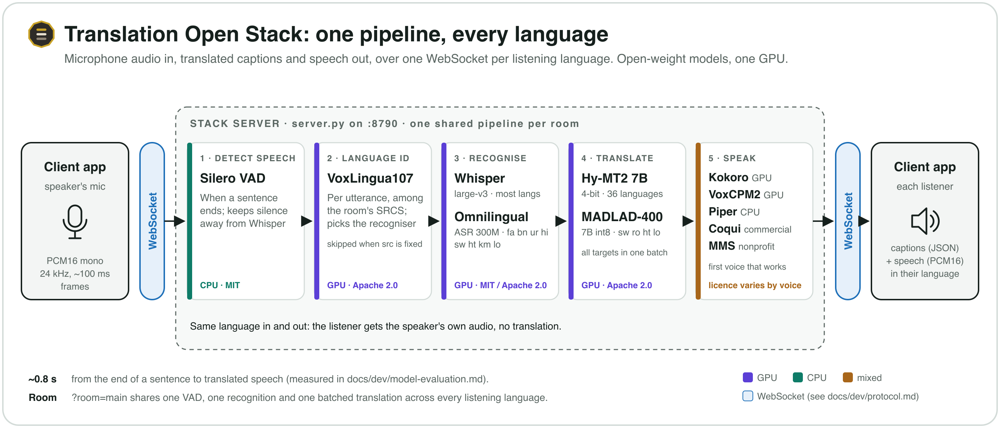
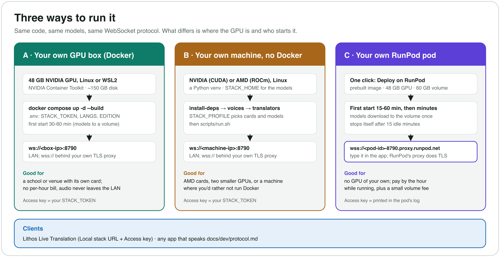

# Translation Open Stack

**Speech in, translated speech out, in 25 languages, from open-weight models on
one GPU you control.** A WebSocket server: a client streams microphone audio in
and gets back captions and spoken translation for every language its listeners
need. One pipeline serves every language (voice detection, language ID,
recognition, one batched translation, a voice per language), so the GPU bill
doesn't grow with the number of languages, and no audio leaves the machine. It
is the "Local stack" provider for Lithos Live Translation and Lithos Talk, and
any client that speaks [the protocol](docs/dev/protocol.md) can use it.



> **Licences.** This repository's code is [Apache 2.0](LICENSE). The models it
> downloads are **not** covered by that licence: each keeps its own, and some
> are **non-commercial**. Read [docs/licences.md](docs/licences.md) before you
> deploy it commercially.

## What you need

- **An NVIDIA GPU with 48 GB** (L40, L40S, RTX 6000 Ada, A6000, RTX PRO
  5000/6000). 32 GB works with a smaller translator; 80 GB+ also runs Gemma 4
  for the directions it translates best.
- **Linux or Windows WSL2**, Docker with the NVIDIA Container Toolkit.
- **~150 GB free disk** and internet for the first start (~60 GB of downloads).

No GPU? Rent one on RunPod (below). Full requirements:
[user guide](docs/user-guide.md#before-you-start).

## Quick start (Docker)

```bash
git clone https://github.com/lithsec/translation-open-stack.git && cd translation-open-stack
cp .env.example .env            # set STACK_TOKEN=$(openssl rand -hex 32); LANGS, EDITION if needed
docker compose up -d --build    # first start: 30-60 min to download and build the models
docker compose logs -f          # ready at "[stack] ready on :8790"
curl http://localhost:8790/health   # "ok"
```

**Try it.** Stream a test clip and get Spanish captions and speech back
(saved to `out-es.wav`):

```bash
pip install websockets
STACK_TOKEN=<your token> python3 tools/client.py --lang es --wav tests/audio/en.wav
```

Then point your app at `ws://<gpu-box-ip>:8790` with the token as its access
key ([connect apps](docs/user-guide.md#connect-apps)). The token is the only
lock: never expose port 8790 to the internet without one, and use TLS beyond
your LAN.

## Other ways to run it

- **RunPod, one click.** **[Deploy on RunPod](https://console.runpod.io/deploy?template=dftcc24b6q)**
  (the prebuilt image `ghcr.io/lithsec/translation-open-stack`) on a 48 GB GPU,
  or 80 GB+ to add Gemma 4. Connect to `wss://<pod-id>-8790.proxy.runpod.net`
  with the access key the pod prints in its log. The pod stops itself when idle.
  [Steps](docs/user-guide.md#one-click-the-runpod-template).
- **Without Docker.** NVIDIA or AMD (ROCm) on Linux, in a Python virtualenv:
  for AMD cards, two GPUs, or no Docker.
  [Steps](docs/user-guide.md#install-without-docker-linux-nvidia-or-amd).



## Where next

| To | Read |
|---|---|
| Install, connect apps, pick languages, swap voices and models, size GPUs, troubleshoot | [docs/user-guide.md](docs/user-guide.md) |
| Look up a variable, a `languages.toml` key, a command or a close code | [docs/reference.md](docs/reference.md) |
| Check each model's and voice's licence, and what `EDITION=commercial` changes | [docs/licences.md](docs/licences.md) |
| Write a client | [docs/dev/protocol.md](docs/dev/protocol.md) |
| Understand the server, or add a recogniser, translator or voice | [docs/dev/architecture.md](docs/dev/architecture.md), [docs/dev/adding-an-engine.md](docs/dev/adding-an-engine.md) |
| Run the Omnilingual hearing services on Google Cloud Run | [services/omni-stt/README.md](services/omni-stt/README.md#one-click-setup-open-in-cloud-shell) |
| See what was tested and why it won | [docs/dev/model-evaluation.md](docs/dev/model-evaluation.md) (raw data in [eval/](eval/README.md)) |
| Learn from what broke | [docs/dev/lessons-learned.md](docs/dev/lessons-learned.md) |

## Licence

Copyright 2026 Vortas, LLC. Licensed under the [Apache License, Version 2.0](LICENSE);
see [NOTICE](NOTICE). This code was developed for Lithos Live Translation
(translate.lithos.community) and is published here under Apache 2.0 by its
copyright holder.

The third-party models, voices and libraries it downloads keep their own
licences, and some are non-commercial (Meta's MMS-TTS and several Piper
voices). `EDITION=commercial` loads only what is classified as commercially
usable, enforced by code; `python3 server/stack_config.py check --edition
commercial` shows what you would get. Every component, its licence and the
checklist before commercial use: [docs/licences.md](docs/licences.md). Not
legal advice.
