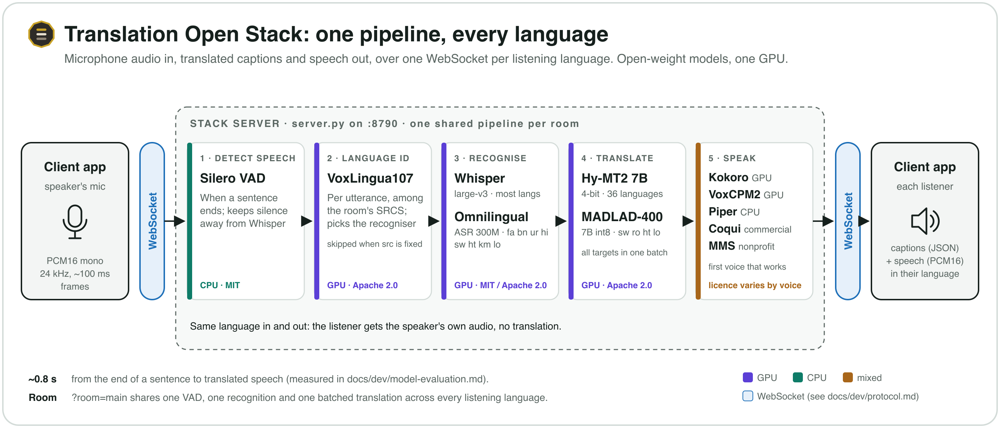
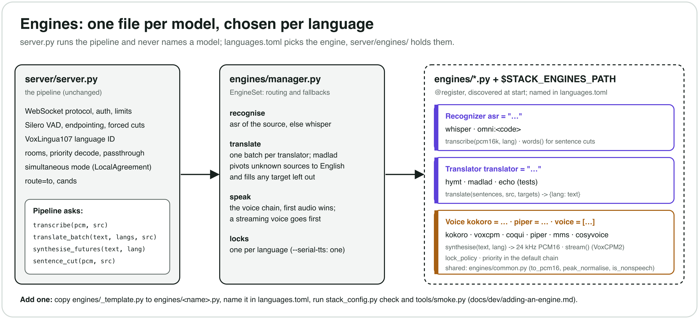

# Architecture

How the server is put together. What each stage does and why is in the
[reference, "The models, stage by stage"](../reference.md#the-models-stage-by-stage)
and [lessons-learned.md](lessons-learned.md); the wire protocol in
[protocol.md](protocol.md); how to add a model in
[adding-an-engine.md](adding-an-engine.md).

The pipeline is one process (`server/server.py`, the entry point, and the
modules beside it) that serves every language:
speech detection, language ID, recognition once per utterance, one batched
translation for every listening language, and a voice per language. The
models behind recognition, translation and voices are **engines**, one file
each, chosen per language in `languages.toml`:

## Module map

| File | What it holds |
|---|---|
| `server/server.py` | The entry point (`python3 server/server.py`, `--help` lists the flags): `main()` and the flags, the token and connection-limit gate (`guarded`, `connection_edition`), warm-up, `/health`, starting the WebSocket server. Re-exports the names of the modules below, so `server.py` read as a module still has them. |
| `server/pipeline.py` | The models every connection shares: `Pipeline` owns Silero VAD and VoxLingua107 language ID, and an `EngineSet` per edition for everything else (sentence cuts, translate, synthesise, the agree turn). The language config it loads (`languages.toml`, `[models]`, `[devices]`), the turn rules (`endpointing`, `short_turn`; `--endpoint-ms`, `--long-utterance-s` and `--max-utterance-s` are set here by `main()`), the `LITHOS_STREAM_*` / `LITHOS_TRIM*` / passthrough / language-switch tunables, `TTS_POOL`, forced cuts (`forced_cut`, `quietest_cut`), LocalAgreement's `common_prefix_words`. |
| `server/connection.py` | What one connection may send (frame size, `AudioMeter`'s speed limit, the close codes, `?room=` and `?cands=` bounds), `clean()` for client text in the log, and the send helpers shared by solo and room connections (`Fanout`, `send_json`, `send_speech`, `speak_to`). |
| `server/rooms.py` | Rooms: `Room`, `ROOMS` (keyed by token subject), `handle_room` (the primary, the worker queue, promotion when the primary leaves), utterance mode (`room_utterance`: shared VAD/ASR/MT, priority decode, passthrough) and simultaneous mode (`room_pass`: LocalAgreement, trimming, `room_flush` and the clause and agree commit policies). |
| `server/handlers.py` | One connection after `guarded` admits it: `handle` (`parse_request` validates the query, the hello) and the solo paths, utterance mode (`route=to`, `cands`) and `--streaming` (`handle_streaming`). |
| `server/audio_in.py` | `AudioIn`: buffers client audio per connection and hands out fixed 16 kHz blocks (stateful 24 to 16 kHz resampling), so the result never depends on message size; `vad_block`; `QuietBoost` for a quiet talker after a loud one. |
| `server/agree.py` | The `?policy=agree` commit policy for simultaneous mode: speak only what two successive Gemma translations of the turn agree on. Which directions may agree (`AGREE_TARGETS`, `AGREE_SOURCES_TO_EN`). |
| `server/translation_context.py` | `TranslationMemory`: the previous pieces and translations a `?context=1` connection or room gives its translator, bounded, forgotten on a language change or after 30 s idle. |
| `server/stack_auth.py` | Who may connect: signed tokens (`STACK_SIGNING_KEY`, with an audience claim) or one static token (`STACK_TOKEN`). |
| `server/stack_config.py` | Reads and validates `languages.toml` (language tables, `[models]`, `[devices]`, profiles) against the registered engines, applies the edition; `check`, `engines`, `docs`, `get`, `piper`, `uses`, `voxcpm-plan`, `profiles`, `profile`, `profile-env` for people and scripts. |
| `server/licences.py` | Every model and voice the stack can load, with its licence class: what `EDITION=commercial` may load. The tables in [licences.md](../licences.md) are generated from it. |
| `server/voxcpm_service.py` | The VoxCPM2 service: reference-voice cloning, stateful 48 to 24 kHz resampling, streaming gain and soft limiter. Runs in its own virtualenv. |
| `server/engines/__init__.py` | The registry: `@register`, discovery of `engines/*.py` and `STACK_ENGINES_PATH`. |
| `server/engines/base.py` | The interfaces (`Recognizer`, `Translator`, `Voice`), `Context`, `AudioStream`, the audio rates. |
| `server/engines/manager.py` | `EngineSet`: loads the enabled engines in order, routes each language to its engine with the fallbacks, runs the voice chain, holds the per-language voice locks. |
| `server/engines/common.py` | Shared helpers: devices, `to_pcm16` (resample, pad, ramp), `peak_normalise`, `trim_silence`, sentence splitting and joining, the non-speech filter, the Omnilingual repetition guard, `hf_snapshot`. |
| `server/engines/whisper.py` | faster-whisper, English and multilingual slots, the segment gates, word timings for sentence cuts. |
| `server/engines/omnilingual.py` | Omnilingual ASR (`asr = "omni:<code>"`), base and large cards (`omni = "large"`, `"large-only"`, `"base"`). |
| `server/engines/hymt.py` | Hy-MT2 7B 4-bit (`HYMT_NAMES`, the prompt with and without context, its lock). |
| `server/engines/madlad.py` | MADLAD-400 through CTranslate2 or transformers: the fallback translator and the English pivot (`MT_BEAM`). |
| `server/engines/llmmt.py` | An LLM translator served beside the stack by vLLM (Gemma 4 on :8101, MiLMMT-46 on :8102), named per language by `llmmt = "<style> <url> <model>"` (or a list of them, first that answers wins); health checks, so a list like `["llmmt", "hymt"]` falls back while no server is up. |
| `server/engines/kokoro.py`, `voxcpm.py`, `coqui.py`, `piper.py`, `mms.py`, `cosyvoice.py` | The voices. `voxcpm.py` is an HTTP client of `server/voxcpm_service.py`. |
| `server/engines/espeak.py` | eSpeak NG, the implicit last voice of every language it speaks. |
| `server/engines/echo.py` | A test translator (source text back). |
| `server/engines/_template.py` | A copy-me example engine (not loaded). |

## Per-utterance flow

1. Audio arrives (24 kHz PCM16). `AudioIn` resamples it to 16 kHz in fixed
   blocks for the connection's or room's own Silero copy (`Pipeline.new_vad`).
2. An endpoint (or a forced cut, placed with the recogniser's word timings by
   `Pipeline.sentence_cut`) closes an utterance.
3. With `src=auto`, `Pipeline.identify_conf` picks the source language among
   `--srcs` (or `cands`).
4. `Pipeline.transcribe` → `EngineSet.recognizer_for(src)` → that engine's
   `transcribe`.
5. `Pipeline.translate_batch` → `EngineSet.translate_batch`: targets grouped by
   translator, one batch each, MADLAD for the pivot and the gaps. A room's
   `priority` language gets its own call first. With `?context=1`, the
   `TranslationMemory` hands the previous two pieces and the last translation
   to a translator that declares `takes_context` (Hy-MT2 and llmmt put them in
   the prompt as context only; MADLAD cannot take them), and records the piece
   afterwards.
6. `Pipeline.synthesise_futures` → `EngineSet.synthesise_futures`: one pool task
   per sentence through the language's voice chain (or one lazy stream per
   sentence for a streaming voice), sent in order as each is ready.

Steps 1-3 and the choreography around 4-6 (rooms, passthrough, streaming
commits, the agree policy) do not depend on which engines run.

## Design choices

- **Explicit discovery, no entry points.** Every non-underscore module in
  `server/engines/` is imported in name order, then each `STACK_ENGINES_PATH`
  directory. A new in-tree engine is one new file; an out-of-tree one is one
  file plus one environment variable. `stack_config.py engines` lists what was
  found and from which file.
- **Names are configuration.** `languages.toml` names models per language
  (`asr`, `translator`, the voice keys). Those keys accept any registered
  name, and a voice's per-language value lives under its own name, as
  `piper = "..."` does. `voice = [...]` sets the chain order.
- **Built-ins follow the flags.** `scripts/run.sh` decides what a deployment
  runs (`--kokoro`, `--hymt DIR`, `--omni`, `--mms`/`--coqui` by edition); a
  new engine loads when a served language names it.
- **Fallbacks are fixed.** Whisper and MADLAD always load and catch whatever
  another engine can't serve. Nothing else is special-cased by name except
  Hy-MT2 being the default translator.
- **The routing is tested.** `tests/test_engines.py` keeps a reference copy of
  the original `translate_batch` and voice chain and compares them with
  `EngineSet` over many language sets, sources, failures and texts.
- **Import must be cheap.** `stack_config.py` imports the engines to validate
  names on machines without torch, so every heavy import happens in `load()`.
