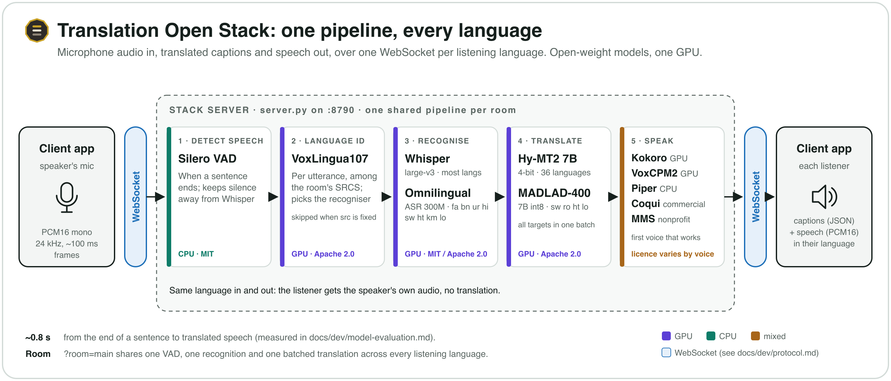

# The stack's wire protocol

One WebSocket per target language. Send microphone audio, receive translated
text and speech. Nothing in it is specific to any Lithos app: anything that can
open a socket and handle PCM can use the stack.



## Connect

```
ws://HOST:8790/translate?lang=es&src=auto&room=main
Authorization: Bearer <token>
```

On RunPod, `HOST:8790` is `<pod-id>-8790.proxy.runpod.net` over `wss://` (the
proxy terminates TLS on 443): `wss://<pod-id>-8790.proxy.runpod.net/translate?lang=es`.

### Authentication

Every WebSocket must carry a token, unless the server was started with
`STACK_OPEN=1` on a private LAN. Send it as a header:

```
Authorization: Bearer <token>
```

The token is either the server's static `STACK_TOKEN`, or a short-lived token
signed with `STACK_SIGNING_KEY` (see `server/stack_auth.py`; issued by whatever
starts the stack for your apps). A signed token's payload is `{"sub", "iat", "exp", "aud"}`:

- `aud` must be `"stack"`. The pod's optional ready report (`STACK_REPORT_URL`) is
  signed with the same key but carries `"aud": "report"`, and never opens a
  connection. A token with no `aud` (issued before audiences
  existed) is refused unless the stack runs with `STACK_ACCEPT_LEGACY_TOKENS=1`,
  a switch meant only for a transition; even then a `pod:` subject is refused.
- `exp` must be a finite number, and the token may live at most 24 hours
  (`exp - iat`, and `exp - now`). For clients that can't set headers, the token also works as the first
path segment (`wss://HOST/<token>/translate?...`) or as `?key=<token>`, but a
URL ends up in proxy and server logs, so prefer the header. A bad or missing
token closes the socket; the server logs `refused: bad or missing token`.
`GET /health` needs no token and answers 200 once the models are loaded.

Each token subject may hold `STACK_MAX_PER_CLIENT` connections (default 30),
the server `STACK_MAX_CONNECTIONS` in total (60), and a connection lasts at
most `STACK_MAX_SESSION_MIN` minutes (360).

### Limits and close codes

| code | when |
|---|---|
| 4401 | bad or missing token (including a token for another audience) |
| 4429 | too many connections for this subject, or for the server |
| 4403 | the token names an edition this stack doesn't serve (`ed: "commercial"` on an `EDITION=nonprofit` stack) |
| 4408 | the connection reached `STACK_MAX_SESSION_MIN` |
| 4400 | a query parameter the server does not accept (an `error` message says which, first) |
| 4413 | audio sent faster than 2x real time |
| 1009 | a WebSocket message over 256 KB |

- **Message size:** at most 256 KB per message (a 100 ms frame is 4.8 KB).
- **Audio rate:** a connection may send audio at up to 2x real time, with up
  to 60 s of audio in hand beyond that (the backlog a client builds while the
  server is busy and not reading). Faster than that is not a microphone; the
  server closes with 4413. Send at real time.

| parameter | required | meaning |
|---|---|---|
| `lang` | yes | target language to receive, e.g. `es`: one of the server's `--langs` (a region subtag is dropped: `es-ES` is served as `es`) |
| `src` | no (default `en`) | source language (`en` or one of `--srcs`), or `auto` to identify it per utterance |
| `room` | no | share ONE pipeline across connections — see below. 1-64 letters, digits, `-` or `_` |
| `stream` | no | `1` = simultaneous mode: commit and speak clauses while the speaker is still talking |
| `policy` | no | with `stream=1` in a room: `clause` (the default, or `LITHOS_STREAM_POLICY`) cuts the committed words into clauses; `agree` lets Gemma decide: only what two successive translations of the turn so far agree on is spoken (`server/agree.py`). Agree runs on the directions Gemma serves that it lists; the rest keep `clause`. The primary connection's value counts |
| `priority` | no | `1` = translate this language ahead of the others in the room |
| `route` | no | `to` (the only value; no room) = translate whatever is spoken INTO `lang` and skip speech already in `lang`: one connection per direction of a two-way conversation |
| `cands` | no | with `src=auto`, no room: the only languages the conversation uses, e.g. `en,es`. Detection chooses among these instead of every language the server knows. At most 8, each a language the server knows |
| `context` | no | `1` = give the translator the previous pieces as context — see [Context from the previous pieces](#context-from-the-previous-pieces). Off by default; in a room, the primary connection's value counts |

Parameters are checked before `hello`. An unknown `lang`, `src`, `route`,
`cands` language or a malformed `room` gets one message,
`{"type":"error","detail":"..."}` naming the parameter (and, for `lang` and
`src`, what the server does serve), then close code 4400.

Audio frames are at most 64 KB; a long sentence arrives in several.

The server replies immediately:

```json
{"type":"hello","lang":"es","src":"auto","rate":24000,"mode":"utterance","edition":"commercial"}
```

`rate` is authoritative — use it rather than assuming 24000. `edition` is the
edition (voices and translators) this connection is served in (`EDITION=both`
picks it from the token's `ed` claim; a client that must not hear
non-commercial voices can check it says `commercial`). A connection that asked for `context=1` also gets
`"context": true`; without it the field is absent.

## Send

Binary frames of **mono PCM16 little-endian at the `rate` from `hello`**
(24 kHz). Send continuously, including silence; the server's VAD decides where
utterances begin and end. ~100 ms per frame is a good size.

Do not send JSON upstream. The server ignores it.

## Receive

**Text**, as JSON:

```json
{"type":"route","src":"es"}                      // which language was detected (src=auto only)
{"type":"inputTranscript","text":"..."}          // what was HEARD, in the source language
{"type":"transcript","delta":"..."}              // the translation, appendable
{"type":"error","detail":"..."}                  // fatal for this connection
```

`transcript` is a **delta**: append it, do not replace. In simultaneous mode
several arrive per utterance.

**Audio**, as binary frames: mono PCM16 at the `hello` rate, the spoken
translation. One utterance may arrive as several messages (synthesis streams
per sentence).

### Pace the audio before you play it

The server sends each sentence as soon as it is synthesised, which is faster
than real time. Feeding that straight into a player's queue will overrun it.
Lithos Live Translation's desktop client releases it at real time with a
small lead ahead of playback (its `AudioPacer`). This is the single thing most
likely to bite a new client.

## Rooms

Without `room`, every connection runs its own pipeline: N languages means N
transcriptions of identical audio.

With `?room=main`, connections share one pipeline. The FIRST connection is the
primary and drives it; the others have their audio drained and discarded, and
receive their own language's output. One VAD, one ASR, one batched translation,
TTS per language.

**Use a room whenever one microphone serves several languages.** It is the
difference between the last language arriving 15 s after the first and all of
them arriving within 0.1 s.

Room-wide settings come from the primary connection, so every client in a room
must pass the same `stream` and `policy` values.

**A room belongs to the token that opened it.** Rooms are keyed by the token's
subject and the `room` id together, so two clients with different tokens that
both say `room=main` get two separate rooms: neither hears the other's
transcripts or audio, drives the other's pipeline, or displaces the other's
listeners. Connections that share a subject (Live Translation's sessions, all
`client:<name>`; one Lithos Talk account's devices, `talk:<account>`) share the
room, and the first of them to join is the primary, as above; if it leaves,
another member is promoted.

Several connections may listen to the same language in one room. Each receives
the output (translated and synthesised once, sent to each), and one leaving
takes only itself out.

## Same language in, same language out

A connection whose `lang` equals the detected source gets the **microphone
audio itself**, not a synthesised re-reading of the speaker's own words — no MT
and no TTS in the path. Only when language identification is confident;
otherwise it falls back to translating.

## Context from the previous pieces

Each utterance (or, in simultaneous mode, each clause) is translated on its
own, so a short piece loses what the piece before settled: a name, the
subject of a sentence cut in two. In
[eval/2026-10-continuous-ht](../../eval/2026-10-continuous-ht/README.md),
cutting at breaths took a 0-3 grade from 2.52 to 2.15-2.21, and sending the
previous two pieces and the last translation as context brought it back to
2.52-2.67 (with a cloud LLM as the translator). `context=1` does the same
with the stack's own translators:

- **What is kept** (`server/translation_context.py`): the last 2 source pieces
  as heard, and the newest translation into each listening language. At most
  600 characters of source and 300 per translation (the end of a longer text
  is kept).
- **When it is forgotten**: when the source language changes (the `src` you
  connected with, or the `route` detected per utterance), and after 30 s
  without a translated piece. A room keeps one memory, set by the primary
  connection's `context` value, like `stream`.
- **Which translators use it**: the prompted ones, **Hy-MT2** and **llmmt**
  (Gemma 4, MiLMMT), which get it in the prompt marked as context only
  (`server/engines/hymt.py`, `server/engines/llmmt.py`). **MADLAD** takes one
  tagged sentence, so a target it serves translates each piece alone. A
  source pivoted through English gets no context either.
- **What it changes** is only the translation of the current piece. With the
  option off, the translation calls are exactly the ones made without it
  (`tests/test_translation_context.py`).

Whether context helps Hy-MT2 as it helped the cloud LLM is not measured.
There is no text-only input: the option applies to what is heard.

## A minimal client

```python
import asyncio, json, websockets

async def main():
    url = "ws://HOST:8790/translate?lang=es&src=auto&room=main"
    headers = {"Authorization": "Bearer " + TOKEN}
    # websockets >= 14; older versions call this argument extra_headers
    async with websockets.connect(url, max_size=2**24, additional_headers=headers) as ws:
        hello = json.loads(await ws.recv())
        rate = hello["rate"]

        async def receive():
            async for m in ws:
                if isinstance(m, bytes):
                    play(m)                      # PCM16 @ rate — pace it!
                else:
                    d = json.loads(m)
                    if d.get("type") == "transcript":
                        caption_append(d["delta"])

        asyncio.create_task(receive())
        while True:
            await ws.send(next_mic_frame())      # PCM16 @ rate
            await asyncio.sleep(0.1)

asyncio.run(main())
```

A complete client that streams a WAV at real-time pace, saves the audio and
prints the delay from end of utterance to first audio back is
[`tools/client.py`](../../tools/client.py):

```bash
STACK_TOKEN=... python3 tools/client.py --url wss://<pod-id>-8790.proxy.runpod.net --lang es --wav talk.wav
python3 tools/client.py --host 192.168.1.20 --token <token> --lang es --src auto --wav talk.wav
```

The token comes from `--token` or `$STACK_TOKEN` and travels in the
`Authorization` header; the WAV must be 24 kHz mono PCM16.

## Behaviour worth knowing

- **Nothing is sent until the speaker pauses** (utterance mode). A long
  unbroken reading is cut at the maximum utterance length (`--max-utterance-s`:
  12 s as `scripts/run.sh` starts the server, 9 s when `server.py` is run
  bare; a language may set its own, e.g. `max_utterance_s` in
  `languages.toml`), after the last sentence the recogniser heard, so output
  does not wait for the paragraph to end. This applies to every connection.
- **Silence is safe to send.** The server will not transcribe an idle
  microphone.
- **A dead connection is one client's problem.** Each is guarded; one failing
  does not disturb the room.
- **The token is the only lock.** There are no user accounts; anyone with the
  token can use the stack, within the connection limits, and a room is shared
  only by connections with the same token subject. Keep it out of URLs,
  and use `wss://` (TLS) anywhere beyond a private LAN.
