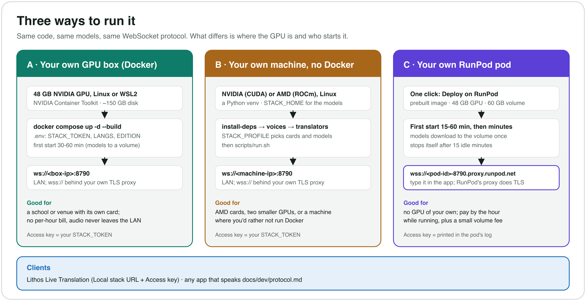

# User guide

How to install, run, connect, configure and check the Translation Open Stack, task
by task. Every variable, `languages.toml` key, command and pin is listed in
the [reference](reference.md); licences are in [licences.md](licences.md).

**Tasks**

- [Before you start](#before-you-start)
- [Install on your own GPU (Docker)](#install-on-your-own-gpu-docker)
- [Install without Docker (Linux: NVIDIA or AMD)](#install-without-docker-linux-nvidia-or-amd)
- [Run on your own RunPod pod](#run-on-your-own-runpod-pod)
- [Connect apps](#connect-apps)
- [Choose the edition](#choose-the-edition)
- [Pick languages](#pick-languages)
- [Swap a voice](#swap-a-voice)
- [Route a language to another recogniser or translator](#route-a-language-to-another-recogniser-or-translator)
- [Replace a model or a revision](#replace-a-model-or-a-revision)
- [GPUs and capacity](#gpus-and-capacity)
- [Hardware profiles: other GPUs, two GPUs, AMD, Mac](#hardware-profiles-other-gpus-two-gpus-amd-mac)
  - [Create a profile](#create-a-profile)
- [Verify with the smoke test](#verify-with-the-smoke-test)
- [Update](#update)
- [Troubleshooting](#troubleshooting)



## Before you start

| | |
|---|---|
| GPU | **NVIDIA, 48 GB** (RTX 6000 Ada, RTX PRO 5000/6000, L40, L40S, A6000) for all 25 languages: the stack holds ~33 GB before anyone speaks. **32 GB** (RTX 5090, RTX PRO 4500) works with `MADLAD=3b` or without VoxCPM2; see [Fitting a 32 GB card](#fitting-a-32-gb-card). **80 GB+** also runs Gemma 4 for the directions it translates best. Smaller cards aren't supported. |
| OS | Linux with the NVIDIA driver (570 or newer, for CUDA 12.8), or Windows 11 with **WSL2** and the NVIDIA driver for WSL. **Macs can't run it** ([AMD and Mac](#amd-and-mac)). |
| Software | Docker Engine with the Compose plugin (or Docker Desktop on Windows) and the **NVIDIA Container Toolkit**. |
| Disk | ~23 GB for the image, **~38 GB** for the models (kept), and ~48 GB more *during the first start only*, while the translators are built. ~150 GB free is comfortable. |
| CPU / RAM | 8+ cores (Piper voices run on the CPU), 32 GB+ RAM. |
| Network | Internet for the first start (downloads ~60 GB). After that, only your apps need to reach it. |

No GPU of your own? Rent one by the hour: [Run on your own RunPod pod](#run-on-your-own-runpod-pod).

**The token is the only lock.** The stack has no user accounts: anyone with
the token can use it, within the connection limits. It refuses to start
without `STACK_TOKEN` (or `STACK_SIGNING_KEY`, for short-lived tokens from a
launcher). Docker also accepts `STACK_OPEN=1`, only for a private network
where you trust every device. Never forward port 8790 from the internet
without a token, and put the stack behind TLS (a reverse proxy or a tunnel;
RunPod's proxy does this for you). More:
[reference, "Access, rooms and limits"](reference.md#access-rooms-and-limits).

## Install on your own GPU (Docker)

1. **Check the GPU is visible to containers:**

   ```bash
   docker run --rm --gpus all nvidia/cuda:12.8.1-base-ubuntu24.04 nvidia-smi
   ```

2. **Get the code and configure it:**

   ```bash
   git clone https://github.com/lithsec/translation-open-stack.git
   cd translation-open-stack
   cp .env.example .env
   ```

   In `.env`, set `STACK_TOKEN` to a long random string (`openssl rand -hex 32`),
   and `LANGS` / `SRCS` / `EDITION` / `STACK_PROFILE` if you want fewer
   languages, the commercial edition or other hardware. Every variable in the
   [reference](reference.md#environment-variables) works in `.env`.

3. **Build and start:**

   ```bash
   docker compose up -d --build
   docker compose logs -f
   ```

   The build takes about 10 minutes. The **first start then takes 30-60
   minutes**: it downloads the voices and recognition models and builds the
   two translators, all into the `lithos-models` volume. It is ready when the
   log shows `[stack] ready on :8790 for ['en', 'es', ...]`. Later starts take
   a few minutes.

4. **Check it from another machine:**

   ```bash
   curl http://<gpu-box>:8790/health        # "ok" once ready; no token needed
   ```

5. **Connect your apps**: [Connect apps](#connect-apps). On your LAN the URL is
   `ws://<gpu-box-ip>:8790`; from outside, `wss://…` behind your TLS proxy.

The `stack` service runs as the unprivileged user `stack` (uid 10001); the
one-shot `volume-init` service hands it the model volume first. Compose
mounts `languages.toml` and `profiles/` read-only, so you edit them on the
host. It reserves one GPU; for two, change `count: 1` to `count: all` in
`docker-compose.yml`. `docker compose down -v` deletes the model volume, and
the next start downloads and builds everything again.

## Install without Docker (Linux: NVIDIA or AMD)

For an AMD card (the image is NVIDIA-only), or if you'd rather not use
Docker. The steps: **packages, voices, translators, start, smoke test.**

**0. A folder for the models**, about 60 GB; `STACK_HOME` (default `/workspace`):

```bash
git clone https://github.com/lithsec/translation-open-stack.git && cd translation-open-stack
export STACK_HOME=$HOME/tos-data && mkdir -p $STACK_HOME
```

**1. A Python 3.12 virtualenv, with PyTorch for your GPU first.** Python
3.10-3.12 only (Kokoro doesn't install on 3.13+). If your system ships a newer
Python, [uv](https://docs.astral.sh/uv/) fetches 3.12: `uv venv --python 3.12 ~/tos-venv`.

```bash
python3.12 -m venv ~/tos-venv && . ~/tos-venv/bin/activate
# NVIDIA:
pip install torch==2.8.0 torchaudio==2.8.0
# AMD (ROCm):
pip install torch==2.8.0 torchaudio==2.8.0 --index-url https://download.pytorch.org/whl/rocm6.4
python -c "import torch; print(torch.cuda.is_available(), [torch.cuda.get_device_name(i) for i in range(torch.cuda.device_count())])"
```

It must print `True` and your cards (ROCm cards are called `cuda` too). The
`rocm6.4` build brings its own runtime and runs on a ROCm 7.x system; a newer
ROCm build works too (`install-deps.sh` keeps the one it finds).

**2. The stack's packages:** `sudo apt install espeak-ng`, then
`bash scripts/install-deps.sh` (not `pip install -r constraints.txt`). pip
prints three expected `ERROR:` lines about `numpy` and `scipy` versions
(librosa, contourpy); they are harmless. The script ends with `every required
import works` and `Done.`, or lists what is wrong. `VERBOSE=1` shows pip's
full output.

**AMD only, 3. CTranslate2's ROCm build** (Whisper and MADLAD run on it):
download `rocm-python-wheels-Linux.zip` from
[CTranslate2 v4.8.2](https://github.com/OpenNMT/CTranslate2/releases/tag/v4.8.2),
then `pip install --force-reinstall --no-deps <the cp312 wheel in it>`. It is
built against ROCm 7.2 for RDNA 2-4 cards (not Instinct) and loads ROCm 7 from
`/opt/rocm`. Check it sees your cards:

```bash
python -c "import ctranslate2; print(ctranslate2.get_cuda_device_count())"
```

If it fails to load (a missing `libamdhip64.so.7`), install the ROCm 7.2
runtime alongside yours and point `LD_LIBRARY_PATH` at its `lib`, or
[build CTranslate2 from source](https://opennmt.net/CTranslate2/installation.html).

**One copy of ROCm per process.** PyTorch's wheels bring their own ROCm and
CTranslate2 loads the system's; two copies crash (`registered more than
once!`, `LLVM ERROR`, or a segmentation fault). Put PyTorch's copy first, in
every shell that runs the scripts. With AMD's wheels
([issue #8](https://github.com/lithsec/translation-open-stack/issues/8)):

```bash
export LD_LIBRARY_PATH=$VIRTUAL_ENV/lib/python3.12/site-packages/_rocm_sdk_core/lib:$LD_LIBRARY_PATH
```

**4. Profile, voices, translators, start.** The voice and translator steps
run once (about an hour). A new terminal needs the virtualenv, `STACK_HOME`
and `STACK_PROFILE` again.

```bash
export STACK_PROFILE=radeon-32+16     # or cuda-48gb, cuda-32gb, cuda-2gpu, your own
python3 server/stack_config.py profile
bash scripts/fetch-voices.sh          # Piper voices
bash scripts/prepare-voices.sh        # VoxCPM2: its own virtualenv and ~5 GB of weights
bash scripts/prepare-mt.sh            # MADLAD, and Hy-MT2 (4-bit, or bf16 with HYMT_QUANT=bf16)
export STACK_TOKEN=$(openssl rand -hex 32)    # keep it: your apps need it
bash scripts/run.sh
```

`radeon-32+16` sets `HYMT_QUANT=bf16`, which needs no bitsandbytes. `run.sh`
prints the profile and devices, where each model landed
(`[stack] hymt on cuda:0: +15.5 GB`), and `[stack] ready on :8790`.
`WARNING: PyTorch sees no GPU` means everything is on the CPU. If your cards
come up the other way round, `HIP_VISIBLE_DEVICES=1,0` (AMD) or
`CUDA_VISIBLE_DEVICES=1,0` swaps them.

**5. Smoke test**, from another terminal in the same virtualenv:
`STACK_TOKEN=<the token> python tools/smoke.py`.

**On AMD, expect** Omnilingual not to load (fairseq2 has no ROCm builds): its
languages (ht km lo sw hi fa bn ur) fall back to Whisper, weaker for ht km lo
sw. This path is a preview, not yet run end to end on AMD; please report what
happens.

## Run on your own RunPod pod

[RunPod](https://www.runpod.io) rents GPUs by the hour; you pay only while a
pod runs. Everything here is in RunPod's web console; nothing depends on
Lithos servers.

### One click: the RunPod template

The public template runs the published image
`ghcr.io/lithsec/translation-open-stack` (every package installed; model
weights download on first start; GPL programs ship with licence and source in
`/opt/stack/licences`).

1. Open **[Deploy on RunPod](https://console.runpod.io/deploy?template=dftcc24b6q)**.
2. Pick a **48 GB GPU**, or an **80 GB+** one (A100/H100 80 GB, RTX PRO 6000
   96 GB) to also run Gemma 4 31B: on those, `scripts/start-llmmt.sh` starts
   it in vLLM beside the stack (`LLMMT`, see
   [reference](reference.md#translators-per-direction)). Until it answers, and
   on a 48 GB card, its directions use Hy-MT2 or MADLAD. The pod's own 100 GB
   volume holds the models (Gemma 4 and vLLM take about 30 GB of it).
   Optional, under **Edit template**: `EDITION`, `STACK_IDLE_MIN`, `LLMMT`,
   `LANGS` / `SRCS`, or your own `STACK_TOKEN`. Or attach a **network volume**
   of 100 GB+ instead, so the models outlive the pod and a new pod in that
   data center starts in minutes.
3. **Deploy.** Open the pod's **Logs**. Near the top:

   ```
   == connect: wss://<pod-id>-8790.proxy.runpod.net
   == access key: <64 hex characters>
   ```

   With no `STACK_TOKEN` set, the pod makes one, saves it in
   `/workspace/.stack-token` and prints it once; `cat /workspace/.stack-token`
   in the pod's terminal shows it again.
4. **Wait** 30-60 minutes the first time, a few minutes after that. It is
   ready at `[stack] ready on :8790`. Gemma 4 joins about 20-30 minutes after
   the first start (`[stack] llmmt: ... answering`; log: `/workspace/llmmt.log`).
5. Put the URL and the access key in your app ([Connect apps](#connect-apps)).

The pod stops itself when idle (step 7 below).

### By hand

The same setup on the stock image.

1. **Create a network volume**, 60 GB (100 GB+ for Gemma 4), in a data center
   that has the GPU you want (Storage -> Network Volumes; billed monthly). A
   volume attaches only when a pod is created, and only in its own data center.
2. **Put the repository on it.** Deploy any cheap pod with the volume
   attached, open its web terminal, run the line below, then terminate it:

   ```bash
   git clone https://github.com/lithsec/translation-open-stack.git /workspace/translation-open-stack
   ```

3. **Token (optional).** Set `STACK_TOKEN` in the pod's environment (step 4),
   or write it to `/workspace/.stack-token` (`chmod 600`). With neither, the
   pod makes one and prints it in its log, as with the template.
4. **Deploy the stack pod** with the volume attached:
   - GPU: 48 GB (see [Fitting a 32 GB card](#fitting-a-32-gb-card) for less; 80 GB+ for Gemma 4)
   - Image: `runpod/pytorch:1.0.2-cu1281-torch280-ubuntu2404` (or the published
     image above, which skips ~3 minutes of package installs on every boot)
   - Container disk: **80 GB** (the first start builds the translators there)
   - Volume mount path: `/workspace`
   - Expose ports: **HTTP `8790`**, TCP `22`
   - Start command:
     `bash -c 'bash /workspace/translation-open-stack/scripts/runpod/runpod-start.sh > /workspace/stack.log 2>&1 & exec /start.sh'`
   - Environment (optional): `STACK_TOKEN`, `LANGS` / `SRCS` / `EDITION` /
     `MADLAD` and the rest of the [reference](reference.md#environment-variables).
5. **Wait for it.** First start: 30-60 minutes. Later: ~3 minutes of package
   installs on the stock image, then 2-5 minutes loading models.
   `tail -f /workspace/stack.log` shows progress; it is ready at
   `[stack] ready on :8790`.
6. **Connect.** The address is `wss://<pod-id>-8790.proxy.runpod.net`. The pod
   ID is on the pod's card in the console; its **Connect** panel lists the
   same host as `https://`. RunPod's proxy provides TLS and passes WebSockets
   through. The token goes in the app's **Access key** field, not the URL.
   Check it first: `curl https://<pod-id>-8790.proxy.runpod.net/health`
   answers `ok`. Then [Connect apps](#connect-apps).
7. **Stopping.** With no one connected for 15 minutes (`STACK_IDLE_MIN`,
   counted from ready) or after 8 hours regardless (`STACK_MAX_UPTIME_H`), the
   pod stops itself (`scripts/idle-stop.sh`). Billing for compute stops; the
   volume keeps the models. **Start** it again from the console. If it fails
   with "not enough free GPUs", terminate it and deploy a new one with the
   same settings; the volume has everything.

**The ready report.** With `STACK_REPORT_URL` (or `/workspace/.stack-report-url`)
and `STACK_SIGNING_KEY` both set, the pod POSTs a signed "ready" or "failed"
to that URL once the models are loaded. Unset, nothing leaves the pod.

**The pod runs as root**, because RunPod's `/start.sh` (its SSH server) and
volume mount need it. The Docker path runs as uid 10001.

## Connect apps

**Lithos Live Translation**: Operator page -> **Settings -> Advanced provider
settings -> Local stack setup**:

- **Local stack URL**: `ws://<gpu-box-ip>:8790` on your LAN, `wss://…` behind
  TLS, or `wss://<pod-id>-8790.proxy.runpod.net` on RunPod.
- **Access key**: your `STACK_TOKEN` (sent as `Authorization: Bearer`).
- **Launcher**: leave it empty.
- Press **Test**: it should report the server's hello. Then, under
  **Languages**, set each language's provider to **Local stack**.

**Any other client**: open one WebSocket per listening language, send PCM16
audio, receive JSON captions and PCM16 speech. The whole contract, with a
minimal Python client: [the protocol](dev/protocol.md).

```
wss://HOST/translate?lang=es&src=auto&room=main      Authorization: Bearer <token>
```

**From a terminal**, `tools/client.py` streams a 24 kHz mono WAV, prints the
captions and saves the speech to `out-<lang>.wav` (needs `pip install websockets`):

```bash
STACK_TOKEN=... python3 tools/client.py --url wss://<pod-id>-8790.proxy.runpod.net --lang es --wav tests/audio/en.wav
```

## Choose the edition

`EDITION` decides which voices may load. Recognition and translation are the
same in both.

| | `EDITION=nonprofit` (default) | `EDITION=commercial` |
|---|---|---|
| What may load | everything configured | only voices and models licensed for commercial use ([`server/licences.py`](../server/licences.py)); unclear (❓) ones after your own review |
| Non-commercial weights loaded | yes (MMS, several Piper voices) | none |
| Haitian Creole | MMS | Coqui VITS OpenBible (CC-BY-SA) |
| Khmer, Lao, Tagalog | VoxCPM2, else MMS | VoxCPM2 (waits up to 15 s for a free instance), else text only |
| Korean, Turkish, Russian, Arabic, Indonesian, Swahili, Vietnamese | Piper | VoxCPM2; eSpeak NG when every instance is busy past 2 s or VoxCPM2 is not running |
| German; en/es/fr fallbacks | Piper `thorsten`; `lessac`, `davefx`, `siwis` | Piper `mls`; `norman`, `carlfm`, `mls` |
| Persian, Romanian | Piper | **eSpeak NG only** (no commercially licensed voice) |
| VoxCPM2 instances | one | one per GPU with room ([GPUs and capacity](#gpus-and-capacity)) |

Set it in `.env` or the pod's environment. Before you start, see what your
`languages.toml` would get:

```bash
python3 server/stack_config.py check --edition commercial
```

`scripts/run.sh` prints the same at every start: each language's engines and
licence class (✅ permissive, ⚠️ attribution or share-alike, ❓ unclear, ⛔
non-commercial), what was not loaded and why, and the **credits you must
show**. A `[models]` entry the edition may not load stops the start.

What the commercial edition guarantees, and the checklist before commercial
use: [licences.md §2](licences.md#2-editions-what-edition-changes) and
[§10](licences.md#10-before-you-deploy-commercially).

### One server for both editions

`EDITION=both` serves commercial and non-profit clients from one GPU:

- A signed token's `ed` claim (`"commercial"` or `"nonprofit"`) picks the
  edition. With no claim (the static `STACK_TOKEN`), a connection gets
  **commercial**, the stricter set.
- Recognition is shared. Translation and voices follow the connection's
  edition: a commercial connection translates by the commercial table (Lao
  with Gemma 4, never MiLMMT-46), a non-profit one by
  the non-profit table. The models are still loaded once: Hy-MT2, MADLAD and
  Gemma 4's server serve both. MMS serves only non-profit connections, Coqui
  only commercial ones. VoxCPM2's instances are shared.
- Rooms are per edition, and the `hello` message names the edition a
  connection got.
- A commercial client is refused (close code 4403) by a stack running
  `EDITION=nonprofit`. A non-profit client on a commercial stack gets
  commercial voices.

Whether running non-commercial models on a server that also serves paying
clients is acceptable is a licensing question for your organisation: read
[licences.md](licences.md) with that set-up in mind.

## Pick languages

`LANGS` are the languages people **listen** in, `SRCS` the languages people
may **speak** (detected per sentence). Both default to all 25:

| | |
|---|---|
| en English, es Spanish, fr French, pt Portuguese, it Italian, de German | ru Russian, uk Ukrainian, zh Mandarin, ja Japanese, ko Korean, vi Vietnamese |
| ar Arabic, fa Persian, hi Hindi, bn Bengali, ur Urdu, id Indonesian | tr Turkish, tl Tagalog, sw Swahili, km Khmer, lo Lao, ht Haitian Creole |
| ro Romanian | |

```bash
# .env, or the pod's environment
LANGS=en,es,fr,ko
SRCS=en,es
```

Fewer languages start faster and use less CPU, but save little GPU memory:
the big models are shared. What frees GPU memory is `VOXCPM=0` (~7 GB) and
`MADLAD=3b` (~5 GB); see [Fitting a 32 GB card](#fitting-a-32-gb-card). Which
engine serves each language: [licences.md §3](licences.md#3-every-language-per-edition),
or `python3 server/stack_config.py check`.

### Add a language

`languages.toml` (at the repository root) says which model serves each
language. A new language is one section with at least a voice, and
`madlad = "<code>"` if MADLAD's tag differs from the code (Tagalog is `fil`).
Hy-MT2 translates into the languages in `stack_config.HYMT_LANGS`; for any
other, set `translator = "madlad"`.

```toml
# Polish: Piper voice, Hy-MT2 translation, Whisper recognition
[pl]
piper = "pl_PL-gosia-medium"
asr = "whisper"
translator = "hymt"
madlad = "pl"
```

Then:

1. Lock the new Piper voice (only voices in `voices.lock` are downloaded):

   ```bash
   python3 scripts/lock-voices.py pl_PL-gosia-medium
   ```

2. Add `pl` to `LANGS` (and `SRCS`, if people will speak it).
3. Check and restart:

   ```bash
   python3 server/stack_config.py check       # validates the file (also run at every start)
   docker compose up -d --force-recreate      # Docker: picks up the edited file and .env
   ```

   On RunPod, edit `/workspace/translation-open-stack/languages.toml` and
   restart the pod.

For `EDITION=commercial`, a voice with no entry in `server/licences.py` is ❓
and left out until you add its licence there or record your own review in
`[licence_review]` ([Swap a voice](#swap-a-voice)).
[licences.md §7](licences.md#7-piper-voices-one-by-one) lists every voice
already checked.

## Swap a voice

A language's voice is a **fallback chain**, tried in this order: Kokoro,
VoxCPM2, Coqui, Piper, MMS, then eSpeak NG. The first one that is running and
succeeds speaks. `voice = ["piper", "kokoro"]` sets another order.

To change a voice, edit that language's line in `languages.toml`, for
example `piper = "de_DE-mls-medium"` under `[de]`. Edit in place: a `[<lang>]`
section **replaces** that language's built-in defaults, so a section you
write from scratch must keep every key you still want (translator, timing
and the rest).

Then lock the voice and restart, as in [Add a language](#add-a-language).

**Piper voices**: the catalogue is
`https://huggingface.co/rhasspy/piper-voices/resolve/main/voices.json`
(tiers `x_low` to `high`; not every language has every tier). Listen before
deciding, and mind the accent. Check the licence
([licences.md §7](licences.md#7-piper-voices-one-by-one)) before commercial use.

**Kokoro** voices are `kokoro = "<lang_code>:<voice>"` (catalogue:
`hexgrad/Kokoro-82M`), for en es fr it pt ja zh hi.

**VoxCPM2** speaks each language in a reference voice,
`voices/voxcpm/<lang>.wav` ([how they were chosen](../voices/voxcpm/README.md)).
To change one, replace the file and delete its copy in
`/workspace/voices/voxcpm/` (the copy on the volume is never overwritten). To
give a language to VoxCPM2, set `voxcpm = true` in its section (or
`[<lang>.commercial]`); its languages are in
[licences.md §11.2](licences.md#112-candidates).

**The commercial edition's voices** are in `[<lang>.commercial]`: the voice
keys to use instead when `EDITION=commercial` (`asr`, `translator` and
`madlad` still come from `[<lang>]`).

```toml
[ko.commercial]
voxcpm = true
```

A ❓ voice loads in commercial only after you record your own review of its
licence. There is no override for ⛔ (non-commercial) items.

```toml
[licence_review]
"ro_RO-mihai-medium" = "reviewed 2026-10-01 by Example Org: CC0 data; we accept the lessac fine-tune"
```

## Route a language to another recogniser or translator

In a language's section:

- `asr = "whisper"` or `asr = "omni:<code>"` picks the recogniser used when
  that language is **spoken**. Omnilingual takes Meta's codes
  (`omni:khm_Khmr`, `omni:hat_Latn`); it serves fa bn ur hi sw ht km lo by
  default.
- `translator` picks the translator **into** that language: `"hymt"`,
  `"madlad"`, or a list tried in order, such as `["llmmt", "hymt"]` (Gemma 4
  while its server answers, Hy-MT2 otherwise). The shipped choices per
  direction: [reference, "Translators per direction"](reference.md#translators-per-direction).

For no Tencent model at all, set `translator = "madlad"` for every language
and don't build Hy-MT2 (or delete `/workspace/mt/hymt2-7b-nf4`). MADLAD is
weaker ([evaluation](dev/model-evaluation.md)).

`python3 server/stack_config.py check` validates the names; an unknown one is
an error. A new *kind* of recogniser, translator or voice is an engine
([adding-an-engine.md](dev/adding-an-engine.md)).

## Replace a model or a revision

The shared models are pinned in `languages.toml` under `[models]`, each with
its repository and exact revision. A `[models.<name>]` table is **merged key
by key** over the default, so give only what you change:

```toml
[models.whisper]
model = "large-v3-turbo"
revision = ""        # the old revision belongs to large-v3's repo; "" = unpinned
```

Change a Whisper `model` and `revision` together. `""` means unpinned; the
translators and VoxCPM2 must have a revision. Every key:
[reference, "[models.<name>]"](reference.md#modelsname).

Check, restart, then [verify](#verify-with-the-smoke-test):

```bash
python3 server/stack_config.py check
python3 server/stack_config.py get models.hymt.revision   # one value, as the scripts read it
```

In `EDITION=commercial` a changed model must still be allowed in
`server/licences.py`, or the server will not start.

### What must be rebuilt

Only the translators (Hy-MT2 and MADLAD, under `/workspace/mt` and
`/workspace/madlad-ct2`) are built on the volume. Each build records
`<repo> @ <revision>` in `PROVENANCE.txt`, and `scripts/prepare-mt.sh` rebuilds
when that differs from `languages.toml`, swapping the new build in only when it
has finished. The Docker entrypoint and `scripts/runpod/runpod-start.sh` run it
before every start, so a restart picks up a new revision; `scripts/run.sh` on
its own only warns. A build with no `PROVENANCE.txt` is kept; delete the
directory to rebuild it. A rebuild needs a GPU and ~45 GB of scratch
(`MT_SCRATCH`).

Everything else is fetched by revision into caches on the volume on the next
start, so switching back costs nothing. `VOXCPM_REV` wins over `[models.voxcpm]`.

## GPUs and capacity

**What one GPU holds.** With all 25 languages the stack holds **about 33 GB
at idle** (about 26 GB for the server, 7 GB for the VoxCPM2 voice service).
The languages themselves cost little; the large models are fixed. A 48 GB
card leaves room for activations under load. On 80 GB+, Gemma 4 31B takes
about 36 GB more.

**How many rooms.** One RTX PRO 6000 (96 GB) with Gemma 4 serves about
**8 rooms of 4 languages** (32 listeners) at once, adding at most a second
per translation. 12 rooms add about 4 s; 16 fall behind. One 12-language room
keeps up; four don't ([eval/2026-10-room-capacity](../eval/2026-10-room-capacity/)).
That test spoke continuously, so real rooms go further. The connection limits
apply first: 30 per access token (`STACK_MAX_PER_CLIENT`, about 7 rooms of 4
languages) and 60 in all (`STACK_MAX_CONNECTIONS`).

**VoxCPM2 is the part that runs out.** One instance makes one voice at a time
and keeps about two to three listeners in real time. Non-profit routes only
Khmer, Lao and Tagalog to it; commercial routes ten languages (ko tr ru ar id
sw vi km lo tl). Each connection's audio is made separately.

`VOXCPM_INSTANCES` sets how many instances run (`auto`, the commercial
default: one on the main GPU plus one on each other GPU with 10 GB+; `1` in
nonprofit), and `VOXCPM_GPUS=0,1,1` places them exactly. The queue and wait
times are in the [reference](reference.md#voxcpm2-and-espeak-ng).

When every instance is busy, a sentence waits 2 s for one, then eSpeak NG
speaks it, so a busy room hears some sentences in the robotic voice instead of
falling behind. Watch the `VoxCPM2 busy` and `VoxCPM2 stats` log lines.
`python3 server/stack_config.py voxcpm-plan --edition commercial` prints where
the instances would run.

**Two GPUs.** With a second GPU (10 GB+), commercial starts a second instance
there automatically; or move the only one there (`VOXCPM_GPUS=1`) to free
~7 GB on the first. Under Docker, set `count: all` in `docker-compose.yml`
first.

### Fitting a 32 GB card

The ~33 GB idle footprint is past a 32 GB card (RTX PRO 4500, RTX 5090).
`STACK_PROFILE=cuda-32gb` sets `MADLAD=3b` for you. The options:

| Option | Saves | Costs |
|---|---|---|
| `MADLAD=3b` | ~5 GB | Weaker Swahili, Haitian Creole, Lao and Romanian (the languages only MADLAD translates), and weaker Haitian Creole or Romanian speech, which goes through MADLAD to English. |
| VoxCPM2 on another GPU (`VOXCPM_GPUS`, or the server's `--voxcpm http://<other-host>:8791`) | 7.1 GB | A second card. |
| `VOXCPM=0` | ~7 GB | Khmer, Lao and Tagalog speak through MMS (non-profit) or are text only (commercial, where ko tr ru ar id sw vi fall to eSpeak NG). |
| Drop languages | little | Only dropping VoxCPM2 or Omnilingual languages frees GPU memory. |

With `MADLAD=3b` the start builds MADLAD 3B into `/workspace/madlad-ct2`.
Measurements: [model-evaluation.md §5](dev/model-evaluation.md#5-fitting-on-a-24-gb-card).

## Hardware profiles: other GPUs, two GPUs, AMD, Mac

The languages and the edition say *what* is served; a **profile** says *on
what*. It can move each model to a chosen card, swap in a smaller model, set
the scripts' defaults, and reroute a language whose recogniser can't run on
that hardware:

```bash
python3 server/stack_config.py profiles             # what ships
python3 server/stack_config.py profile cuda-2gpu    # exactly what it changes
STACK_PROFILE=cuda-2gpu                             # in .env, or the pod's environment
```

| Profile | Hardware | Status |
|---|---|---|
| `cuda-48gb` | one 48 GB NVIDIA GPU | the reference; same as no profile |
| `cuda-32gb` | one 32 GB NVIDIA GPU | `MADLAD=3b` ([above](#fitting-a-32-gb-card)) |
| `cuda-2gpu` | two NVIDIA GPUs, 24 GB+ each | translators on GPU 0, recognition and voices on GPU 1 |
| `cuda-80gb` | one NVIDIA GPU, 80 GB+ | the reference plus Omnilingual 7B for Lao and Khmer (`OMNI_LARGE=1`) |
| `radeon-32+16` | AMD R9700 32 GB + RX 9060 XT 16 GB | **preview**; [install without Docker](#install-without-docker-linux-nvidia-or-amd) |

### Create a profile

A profile is one small TOML file; every table is optional.

1. **Start from the closest one** in `profiles/` (Docker mounts that folder,
   so no rebuild is needed). The name is the file name without `.toml`.
   `STACK_PROFILE` also takes a path.

   ```bash
   cp profiles/cuda-2gpu.toml profiles/my-box.toml
   ```

2. **Edit it.** A complete example, for two cards where the second is small:

   ```toml
   # One line, shown by `stack_config.py profiles`.
   description = "RTX 4090 24 GB + RTX 4060 Ti 16 GB"

   # Defaults for the start scripts' variables. A value already set in the
   # environment (.env, the pod's variables) wins over these.
   [env]
   VOXCPM_GPUS = "0"          # the VoxCPM2 voice service on the big card
   MADLAD = "3b"              # the smaller fallback translator

   # Which card each model loads on. "default" is everything not listed.
   # Values: auto, cpu, cuda, cuda:<n>, mps. AMD cards are cuda:<n> too.
   [devices]
   default = "cuda:0"
   whisper = "cuda:1"
   omni = "cuda:1"
   kokoro = "cuda:1"
   lid = "cpu"

   # A different model, only while this profile is in use (merged key by key
   # over languages.toml's [models]).
   [models.whisper]
   model = "large-v3-turbo"
   revision = ""              # or the commit you tested; "" = unpinned

   # Language routes for this hardware (merged key by key over the language's
   # table), e.g. Khmer through Whisper where Omnilingual can't run.
   [languages.km]
   asr = "whisper"
   ```

   `[devices]` accepts `default`, `lid` (language ID) and every engine name
   (`python3 server/stack_config.py engines`).

3. **Check it.** Both commands stop with a message naming any mistake:

   ```bash
   python3 server/stack_config.py profile my-box   # exactly what it changes
   STACK_PROFILE=my-box python3 server/stack_config.py check
   ```

4. **Use it:** `STACK_PROFILE=my-box` in `.env` or the pod's environment, then
   restart. The start log begins with `profile: my-box`.

5. **Measure, then adjust.** The log prints each model's share of its card
   (`[stack] whisper on cuda:1: +3.3 GB (3.6 GB in use there)`). Keep a few GB
   free on each card, then run the [smoke test](#verify-with-the-smoke-test).
   `STACK_DEVICES=kokoro=cuda:0` overrides the profile for one start.

A model the stack doesn't already run needs an engine, not a profile
([adding-an-engine.md](dev/adding-an-engine.md)). The full format:
[reference, "Profiles and devices"](reference.md#profiles-and-devices).

### AMD and Mac

**AMD (ROCm).** A native install with `radeon-32+16` (or your own profile):
[Install without Docker](#install-without-docker-linux-nvidia-or-amd). Preview.

**Mac.** Not supported: Docker on a Mac cannot reach the GPU, and CTranslate2
and Omnilingual have no Apple GPU support.

## Verify with the smoke test

After any model, voice or dependency change, run the end-to-end smoke test
against the running stack. It covers every voice engine, both translators,
Omnilingual, concurrent connections, the Lithos Talk pair (`route=to`) and
auth, and must end with `ALL PASSED`:

```bash
ssh -L 8790:127.0.0.1:8790 root@<pod-ip> -p <ssh-port>   # RunPod: tunnel the port first
STACK_TOKEN=... python3 tools/smoke.py                   # --quick, --langs es,km
STACK_TOKEN=... python3 tools/smoke.py --edition commercial
```

`--url` points it elsewhere (default `ws://127.0.0.1:8790`); `--token` passes
the token. `--load N` runs a capacity test instead: N simultaneous
connections into the VoxCPM2 languages, failing any whose first audio comes
more than 4 s after the clip.

The smoke test proves each path works. The CPU tests (`tests/test_protocol.py`)
check only the plumbing; quality changes need the
[evaluation](dev/model-evaluation.md).

## Update

**Docker:** `git pull && docker compose up -d --build`. The volume is kept.

**RunPod (template):** the code ships in the image, so it updates when the
template's image is republished; deploy a new pod to get it.
**RunPod (by hand):** `git -C /workspace/translation-open-stack pull` in a
pod's terminal, then restart the pod.

The next start re-checks every Piper voice against `voices.lock` and rebuilds
a translator whose pinned revision changed. Run the
[smoke test](#verify-with-the-smoke-test) if models or dependencies moved.

## Troubleshooting

- **`could not select device driver "nvidia"`** or **"No NVIDIA GPU visible"**:
  install the NVIDIA Container Toolkit and restart Docker. The `nvidia-smi`
  check in [Install](#install-on-your-own-gpu-docker) must work first. On
  WSL2, install only the Windows NVIDIA driver.
- **Refuses to start, asks for `STACK_TOKEN`**: set it in `.env` (next to
  `docker-compose.yml`), or `STACK_OPEN=1` on a private LAN.
- **First start stops with "No space left on device"**: the translator build
  needs ~48 GB of scratch. Free space and `docker compose up -d` again;
  finished models are kept.
- **"Piper voices failed verification against voices.lock"**: a voice you
  added is `not in voices.lock` (`python3 scripts/lock-voices.py <voice>`), or
  the upstream file changed (`... Refused.`): review it before re-locking
  ([reference](reference.md#piper-voices-voiceslock)).
- **CUDA out of memory**: see [Fitting a 32 GB card](#fitting-a-32-gb-card).
- **A language is text only or silent**: grep the log for it
  (`docker compose logs stack | grep -i "<lang>"`). "no Piper voice mapped",
  "Piper voice unavailable" or `FAILED` means the voice in `languages.toml` is
  wrong or unreachable. In commercial, `check --edition commercial` says why.
- **Khmer/Lao/Tagalog change voice each sentence**: the VoxCPM2 reference
  voices are missing from `/workspace/voices/voxcpm/`;
  `scripts/prepare-voices.sh` copies them there.
- **Some sentences in a robotic voice**: VoxCPM2 was busy; see
  [GPUs and capacity](#gpus-and-capacity).
- **The app's Test fails**: `curl http://<box>:8790/health` from the app's
  machine. No answer: firewall or wrong address. `ok`: check the token (the
  log says `refused: bad or missing token`).
- **A client is disconnected with a code**: 4401 bad token, 4429 too many
  connections, 4408 session time limit, 4400 a bad query parameter, 4413
  audio faster than 2x real time, 1009 a message over 256 KB
  ([reference](reference.md#access-rooms-and-limits)).
- **Two apps with different tokens don't hear each other in `room=main`**: by
  design. A room belongs to one token subject.
- **Port 8790 already in use**: `scripts/run.sh` refuses to start beside an
  old server; stop it first.
- **Choppy or robotic audio on phones**: usually the venue's WiFi (for
  example a phone on 2.4 GHz while the host is on 5 GHz). Packet loss above a
  few percent is a network problem no stack setting fixes.
- **Starting over**: `docker compose down -v` deletes the model volume.
